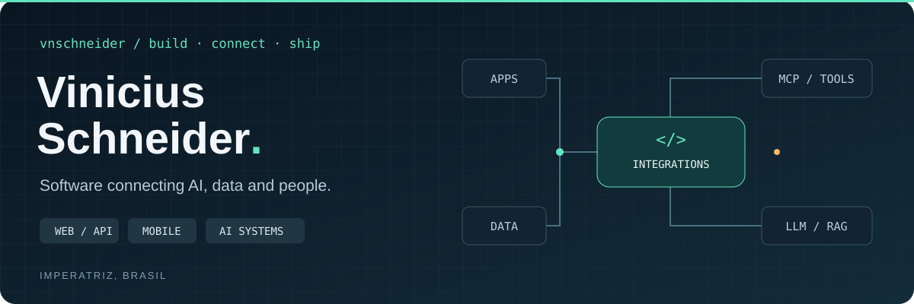

  

  <a href="README.md">Português</a> &nbsp; / &nbsp; <a href="README.en.md">English</a>
  &nbsp; · &nbsp; <a href="https://www.linkedin.com/in/vnschneider/">LinkedIn</a>
  &nbsp; · &nbsp; <a href="mailto:contatovschneider@gmail.com">Contact</a>

I build web applications, Flutter apps and AI integrations. My work connects models to data, documents and actions in existing systems — from tool-enabled chat to MCP servers and RAG applications.

## 01 / Projects in code

<table>
<tr>
<td width="50%" valign="top">
<h3><a href="https://github.com/vnschneider/sabichao">Sabichão ↗</a></h3>

Connects AI assistants to academic workflows: querying data, filling forms, recording activities and generating documents.

MCP · Python · SUAP

</td>
<td width="50%" valign="top">
<h3><a href="https://github.com/fabrica-de-inovacao/expeditto">Expeditto ↗</a></h3>

Collects supporting documents, organizes evidence and generates narratives and PDFs to prepare draft faculty work reports in SUAP.

MCP · Python · Documents

</td>
</tr>
<tr>
<td width="50%" valign="top">
<h3><a href="https://github.com/fabrica-de-inovacao/core-open-library-assistant">CORE ↗</a></h3>

Scientific literature search and organization. My contributions include LLM agents, reranking, asynchronous tasks and telemetry.

Agents · Search · Async processing

</td>
<td width="50%" valign="top">
<h3>COREdu</h3>

Chat for institutional documents, with semantic search, streamed responses and source references.

RAG · FastAPI · React · pgvector

</td>
</tr>
</table>

### Software for everyday workflows

| Product | What I built |
| :--- | :--- |
| **Gestore AI** | AI module for Gestore Workspace, in production for retail clients. Tool-enabled chat for business data, web research and economic indicators. |
| **iCertific** | Application for audio transcription, AI-assisted certificate drafting, review and PDF generation during field work. |
| **Vocal Med** | Clinical documentation assistant: consultation transcription and generation of medical records, prescriptions and certificates. In closed testing with four physicians. |

## 02 / Technologies

   &nbsp;
   &nbsp;
   &nbsp;
   &nbsp;
   &nbsp;
   &nbsp;
   &nbsp;
   &nbsp;

| Applications | Backend & data | AI integrations |
| :--- | :--- | :--- |
| TypeScript · React · Next.js | Python · FastAPI · Node.js | MCP · RAG · Tool calling |
| Dart · Flutter | PostgreSQL · pgvector · Docker | Agents · APIs · Streaming |

## 03 / GitHub activity

  

### Languages & collaboration

  
  

---

<picture>
  <source media="(prefers-color-scheme: dark)" srcset="https://raw.githubusercontent.com/vnschneider/vnschneider/output/github-contribution-grid-snake-dark.svg" />
  
</picture>

Python · TypeScript · Dart &nbsp; / &nbsp; Imperatriz, Brasil

