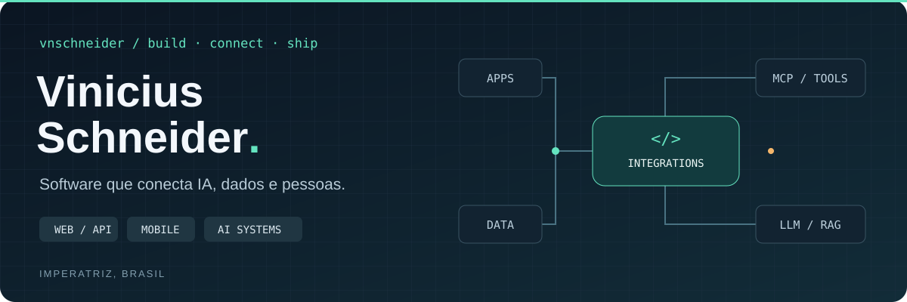

  

  <a href="README.md">Português</a> &nbsp; / &nbsp; <a href="README.en.md">English</a>
  &nbsp; · &nbsp; <a href="https://www.linkedin.com/in/vnschneider/">LinkedIn</a>
  &nbsp; · &nbsp; <a href="mailto:contatovschneider@gmail.com">Contato</a>

Desenvolvo aplicações web, apps Flutter e integrações de IA. Meu trabalho conecta modelos a dados, documentos e ações em sistemas — de um chat com ferramentas a servidores MCP e aplicações com RAG.

## 01 / Projetos em código

<table>
<tr>
<td width="50%" valign="top">
<h3><a href="https://github.com/vnschneider/sabichao">Sabichão ↗</a></h3>

Conecta assistentes de IA à rotina acadêmica: consulta dados, preenche formulários, registra atividades e gera documentos.

MCP · Python · SUAP

</td>
<td width="50%" valign="top">
<h3><a href="https://github.com/fabrica-de-inovacao/expeditto">Expeditto ↗</a></h3>

Reúne comprovantes, organiza evidências e gera relatos e PDFs para preparar o RIT docente como rascunho no SUAP.

MCP · Python · Documentos

</td>
</tr>
<tr>
<td width="50%" valign="top">
<h3><a href="https://github.com/fabrica-de-inovacao/core-open-library-assistant">CORE ↗</a></h3>

Busca e organização de literatura científica. Minhas contribuições incluem agentes LLM, reranking, tarefas assíncronas e telemetria.

Agentes · Busca · Processamento assíncrono

</td>
<td width="50%" valign="top">
<h3>COREdu</h3>

Chat para documentos institucionais, com busca semântica, respostas em streaming e referências às fontes.

RAG · FastAPI · React · pgvector

</td>
</tr>
</table>

### Soluções para o dia a dia

| Solução | O que desenvolvi |
| :--- | :--- |
| **Gestore AI** | Módulo de IA do Gestore Workspace, em produção para varejistas. Chat com ferramentas para consultar dados empresariais, pesquisar na web e reunir indicadores econômicos. |
| **iCertific** | Aplicação para transcrição de áudio, redação assistida de certidões, revisão e geração de PDF durante diligências. |
| **Vocal Med** | Assistente de documentação clínica: transcrição de consultas e geração de prontuários, receitas e atestados. Em testes fechados com quatro médicos. |

## 02 / Tecnologias

   &nbsp;
   &nbsp;
   &nbsp;
   &nbsp;
   &nbsp;
   &nbsp;
   &nbsp;
   &nbsp;

| Aplicações | Backend e dados | Integrações de IA |
| :--- | :--- | :--- |
| TypeScript · React · Next.js | Python · FastAPI · Node.js | MCP · RAG · Tool calling |
| Dart · Flutter | PostgreSQL · pgvector · Docker | Agentes · APIs · Streaming |

## 03 / Atividade no GitHub

  

### Linguagens e colaboração

  
  

---

<picture>
  <source media="(prefers-color-scheme: dark)" srcset="https://raw.githubusercontent.com/vnschneider/vnschneider/output/github-contribution-grid-snake-dark.svg" />
  
</picture>

Python · TypeScript · Dart &nbsp; / &nbsp; Imperatriz, Brasil

